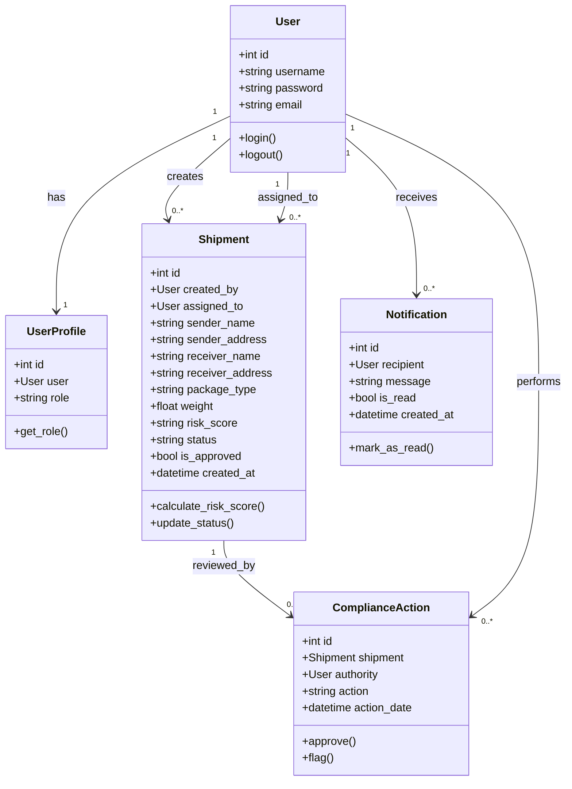
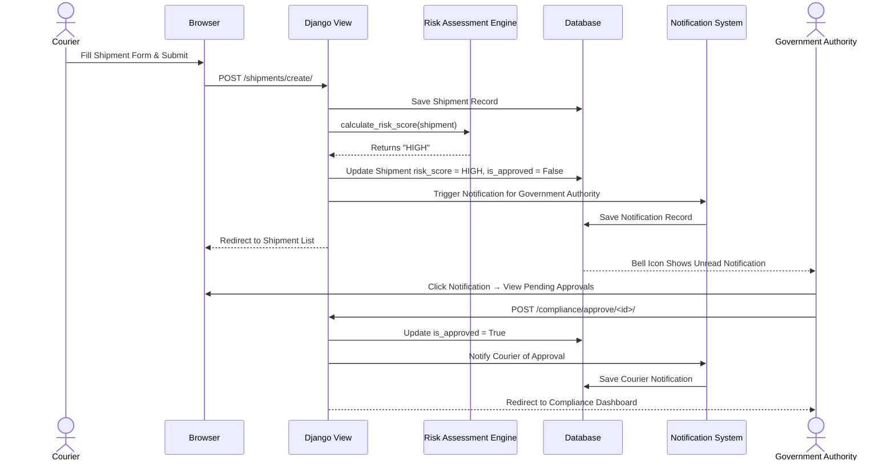
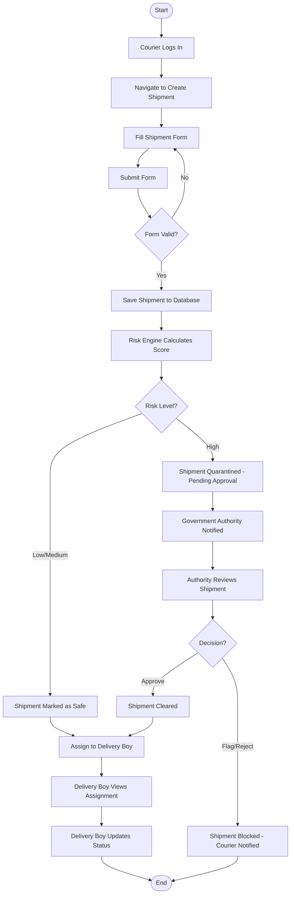
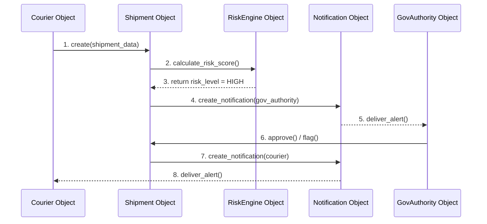
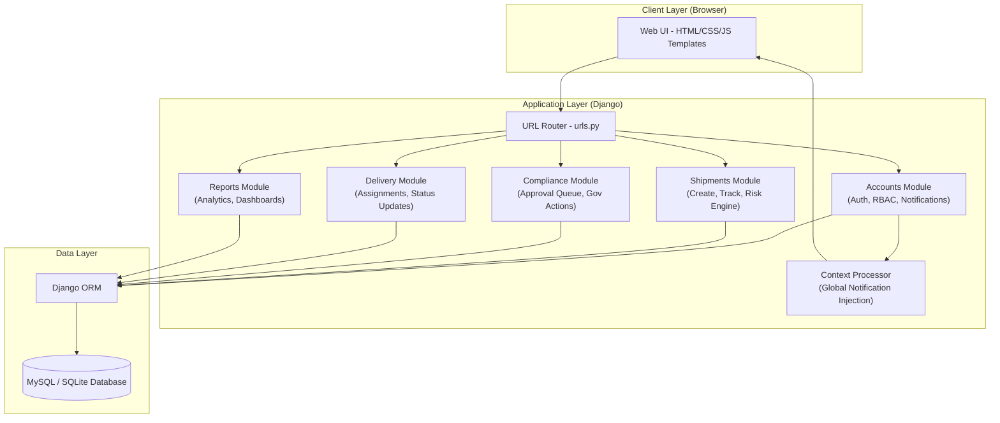
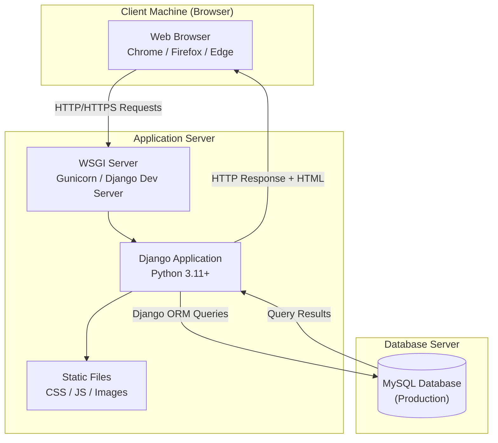
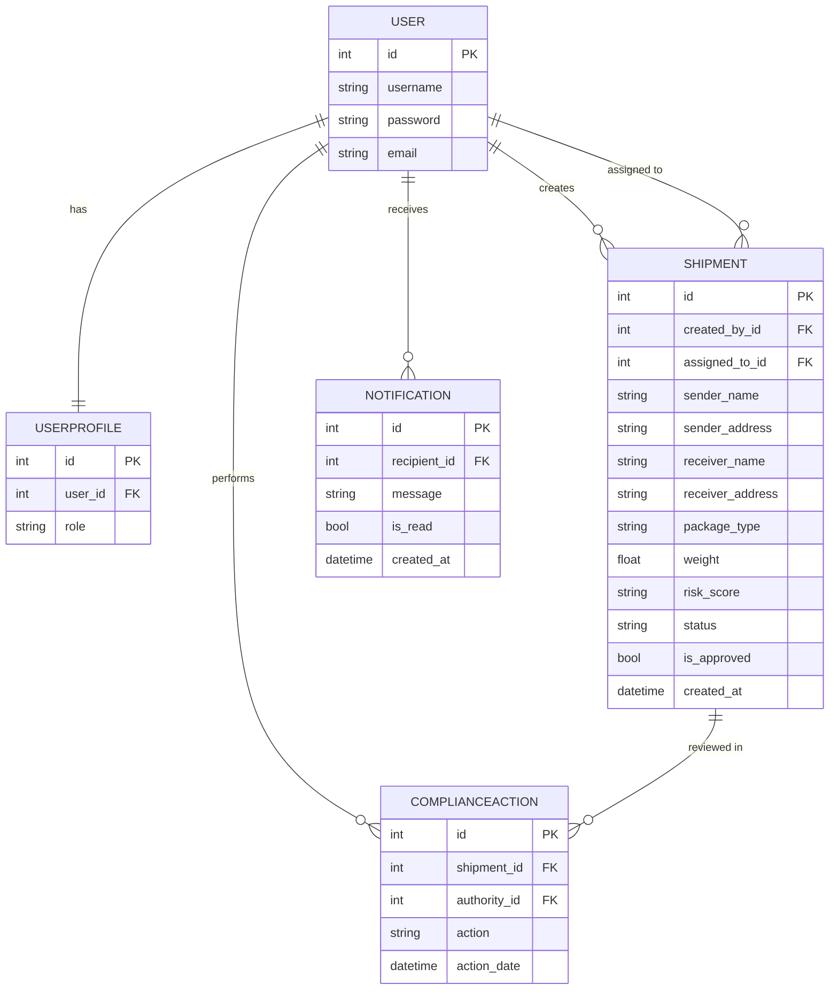
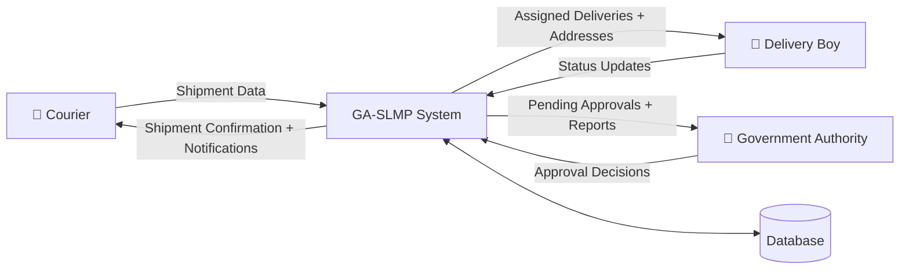
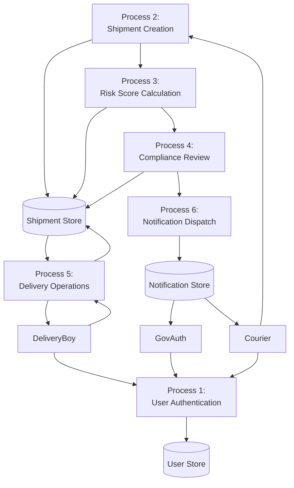

# GOVERNMENT AUTHORIZED SMART LOGISTICS AND PACKAGE MANAGEMENT SYSTEM (GA-SLMP)

A Project Report
Submitted in the partial fulfilment of the requirements
for the award of the degree of
**Master of Computer Applications**

In
**Department of Computer Science and Applications**

By
**KALLEPALLI KOUSHIK**
**Reg. No. 2401600191**

Under the Supervision of
**Dr. B. Krishna**
**Assistant Professor**

Department of Computer Science and Applications
**KONERU LAKSHMAIAH EDUCATIONAL FOUNDATION**
Green Fields, Vaddeswaram, Guntur
District, A.P-522302.
(2024-2026)

---

## DECLARATION
The Project Report entitled “GOVERNMENT AUTHORIZED SMART LOGISTICS AND PACKAGE MANAGEMENT SYSTEM” is a record of Bonafide work by KALLEPALLI KOUSHIK, submitted in partial fulfilment for the award of Master of Computer Applications in Computer Science and Applications at K L UNIVERSITY. The results embodied in this report have not been copied from any other department/university/institute.

*Signature of the Student*
**KALLEPALLI KOUSHIK**
**(2401600191)**

---

## CERTIFICATE
This is to certify that the project report entitled “GOVERNMENT AUTHORIZED SMART LOGISTICS AND PACKAGE MANAGEMENT SYSTEM” submitted by KALLEPALLI KOUSHIK in partial fulfilment of the requirements for the award of Master of Computer Applications in Computer Science and Applications at K L University, is a record of Bonafide work carried out under our guidance and supervision.

**Dr. B. Krishna** 
Assistant Professor  

**Dr. Ch. Kiran Kumar**
Associate Professor & HOD

---

## ACKNOWLEDGEMENT

I am thankful to my guide, **Dr. B. Krishna**, Assistant Professor, Department of CSA, for his valuable guidance and encouragement. His helpful attitude and suggestions have contributed to the successful completion of this project report.

I would like to express my sincere gratitude to **Dr. Ch. Kiran Kumar**, Head of the Department of CSA, for his kind support and encouragement throughout the course of this study and the successful completion of the project report.

I also extend my heartfelt thanks to Dr. M. Kishore Babu, Dean MHS, for their constant support and encouragement, which played a vital role in the completion of this project report.

I sincerely thank the management for providing all the necessary facilities during the course of this study.

Lastly, I would like to express my deep gratitude to everyone who helped, directly or indirectly, in transforming an idea into a working project.

**KALLEPALLI KOUSHIK**
**(2401600191)**

---

## TABLE OF CONTENTS
1. Abstract
2. Introduction
3. Literature Review
4. Problem Statement
5. Requirement Analysis
6. Software Design

---

# 1. Abstract

Modern logistics and courier management networks face significant problems regarding package traceability, regulatory compliance, and security oversight. With the increasing occurrence of unauthorized transport and smuggling of restricted goods, there is an urgent need for an intelligently monitored supply chain. 

The primary objective of the **Government Authorized Smart Logistics and Package Management System (GA-SLMP)** is to design and develop a secure, multi-tiered, role-based application that brings transparency, security, and governmental oversight to the courier sector. The system creates isolated, secure dashboards for distinct entity roles: **Courier Personnel (Administration), Delivery Boys (Operations), and Government Authorities (Oversight and Compliance)**. 

The proposed system adopts an MVC (Model-View-Template) web architecture utilizing the robust Django framework, alongside a relational MySQL database. It introduces features such as real-time compliance notifications, rigorous risk-score generation based on address and package types, and a centralized verification queue for Government authorities to approve or flag high-risk shipments. The expected outcome is a unified digital platform that drastically improves the security and accountability of local and global logistics workflows.

---

# 2. INTRODUCTION

The logistics sector is the backbone of modern commerce. However, as the volume of shipments grows exponentially, ensuring the legality, safety, and transparency of each package has become a logistical nightmare for authorities. The **GA-SLMP** is specialized software that bridges the gap between private courier services and governmental regulatory bodies. 

### 2.1 PROJECT SCOPE

#### 2.1.1 Existing System
The traditional landscape of package management involves fragmented systems where courier companies manage their own private databases. Government entities have little to no real-time oversight over these shipments. Verification and compliance checks are usually manual, random, and paper-based, occurring long after packages have been dispatched.

#### 2.1.2 Disadvantages of Existing System
* **Lack of Real-Time Oversight:** Government bodies cannot inspect shipment details dynamically. 
* **High Fraud & Smuggling Risk:** Without instant compliance validation, restricted items bypass security checks easily.
* **Fragmented Communication:** Delivery boys, courier office admins, and regulatory bodies use entirely separate communication channels, causing delays.

### 2.2 PROPOSED SYSTEM
The proposed system is a unified, highly-secure package tracking platform. By mandating that all shipment data pass through a central database, Government Authorities are instantly notified of high-risk items via algorithmic risk scores.

#### 2.2.1 Advantages of the Proposed System
* **Role-Based Authentication:** Clean separation of concerns between Couriers, Delivery Boys, and Government Authorities.
* **Algorithmic Risk Assessment:** Automatically calculates shipment risk based on sender addresses and package contents. 
* **Instant Notification Protocol:** Real-time pinging for pending approvals and critical security alerts.

### 2.3 FEASIBILITY STUDY
**2.3.1 Technical Feasibility:** The project utilizes the industry-standard Python ecosystem (Django) alongside HTML5/Vanilla CSS for frontend aesthetics. Django's robust built-in ORM ensures secure database handling.
**2.3.2 Economic Feasibility:** Built completely on open-source web technologies. No expensive proprietary licenses are required.
**2.3.3 Operational Feasibility:** Designed with a "Simple-First" philosophy, requiring minimal technical training for delivery boys and courier staff.

---

# 3. LITERATURE REVIEW

The supply chain transparency challenge has been addressed in various research papers, mostly concentrating on blockchain or IoT device tracking. 

**[1] "Smart Logistics: The Role of Web Technologies in Supply Chain Management":** Early approaches heavily relied on purely physical tracking. Current literature strongly points towards digital, cloud-based oversight.

**[2] "Role-Based Access Control (RBAC) in Enterprise Web Applications":** The security paradigm adopted by this project draws directly from established RBAC principles. Ensuring that Delivery Boys cannot overwrite Government Compliance rules is the cornerstone of the GA-SLMP's database architecture.

While massive corporations like FedEx utilize proprietary software, there is a gaping hole in academic research concerning localized, government-integrated platforms intended for regional courier compliance. GA-SLMP directly contributes to literature by proving that rapid, framework-driven development (Django) can successfully enforce national security policies on a micro-scale.

---

# 4. PROBLEM STATEMENT

Managing massive streams of daily packages is heavily prone to security loopholes. Currently, illegal payloads easily bypass checks because local government authorities rely heavily on third-party audits instead of real-time software intercepts. 

**Major Problems:**
1. **Compliance Gap:** Retail logistics operate faster than regulatory bodies can audit them. 
2. **Missing Inter-role Workflows:** Delivery personnel are often unaware of whether a package requires special legal handling.
3. **Information Silos:** Data regarding pending government approvals is lost in manual paperwork, leading to severe delays at courier offices.

---

# 5. REQUIREMENT ANALYSIS

### 5.1 SOFTWARE AND HARDWARE REQUIREMENTS
* **Operating System:** Windows 10/11 (Development/Client).
* **Software Stack:** Python 3.11+, Django web framework, HTML/CSS for UI/UX, MySQL/SQLite database.
* **Hardware:** Any modern consumer-grade CPU (Intel Core i5+), Minimum 4GB RAM.

### 5.2 SOFTWARE REQUIREMENT SPECIFICATION (SRS)

#### 5.2.1 Functional Requirements
* The system shall authenticate users specifically into 3 rigid roles: `Courier`, `Government Authority`, and `Delivery Boy`. 
* The system shall allow Couriers to generate new Shipments, recording deeply granular sender/receiver details.
* The system shall compute an automatic risk score for every package.
* The system shall quarantine high-risk shipments until a Government Authority explicitly grants an "Approval" flag via their dashboard.

#### 5.2.2 Non-Functional Requirements
* The web pages must render rapidly to ensure delivery boys standing at doorsteps aren't delayed. 
* Database queries must be heavily optimized using Django ORM select_related() methodologies stringently. 
* System must display interactive notifications dynamically.

---

# 6. SOFTWARE DESIGN

Software design is the process of defining the architecture, components, modules, interfaces, and data flow of a system to satisfy its specified requirements. It serves as the blueprint that guides the actual implementation of the system.

---

### 6.1 SYSTEM ARCHITECTURE

The GA-SLMP system is built on Django's **MVT (Model-View-Template)** architectural pattern, which cleanly separates the application into three interconnected layers:

* **Model Layer:** Handles Pythonic representations of database tables (e.g., `Shipment`, `User`, `Notification`), managing all data storage and retrieval via Django ORM.
* **View Layer:** Processes HTTP requests, filters user permissions using Python decorators (e.g., `@login_required`, `@user_passes_test`), and triggers background tasks like Risk Assessment.
* **Template Layer:** Generates responsive HTML containing dynamic data using the DTL (Django Template Language).

**Request-Response Flow:**
> User Browser → URL Router → View → Model ↔ Database → Template → HTTP Response → User Browser

---

### 6.2 USE CASE DIAGRAM

```mermaid
graph TD
    Courier["👤 Courier (Admin)"]
    DeliveryBoy["👤 Delivery Boy"]
    GovAuth["👤 Government Authority"]

    UC1["Register / Login"]
    UC2["Create Shipment"]
    UC3["View All Shipments"]
    UC4["Assign Delivery Boy"]
    UC5["View Risk Score"]
    UC6["View Assigned Shipments"]
    UC7["Update Delivery Status"]
    UC8["View Sender/Receiver Address"]
    UC9["View Pending Approvals"]
    UC10["Approve / Flag Shipment"]
    UC11["Receive Notifications"]
    UC12["View Reports Dashboard"]

    Courier --> UC1
    Courier --> UC2
    Courier --> UC3
    Courier --> UC4
    Courier --> UC5
    Courier --> UC11
    Courier --> UC12

    DeliveryBoy --> UC1
    DeliveryBoy --> UC6
    DeliveryBoy --> UC7
    DeliveryBoy --> UC8
    DeliveryBoy --> UC11

    GovAuth --> UC1
    GovAuth --> UC9
    GovAuth --> UC10
    GovAuth --> UC11
    GovAuth --> UC12
```



---

### 6.3 CLASS DIAGRAM



---

### 6.4 SEQUENCE DIAGRAM

**Scenario: Courier Creates a High-Risk Shipment**



---

### 6.5 ACTIVITY DIAGRAM

**Shipment Creation & Approval Workflow:**



---

### 6.6 COLLABORATION DIAGRAM

**Object Interactions During Shipment Approval:**



---

### 6.7 COMPONENT DIAGRAM



---

### 6.8 DEPLOYMENT DIAGRAM



---

### 6.9 ENTITY RELATIONSHIP (ER) DIAGRAM



---

### 6.10 DATA FLOW DIAGRAM (DFD)

**Level 0 — Context Diagram:**



**Level 1 — Internal Data Flow:**



---

# 7. SOURCE CODE (EXPANDED CORE IMPLEMENTATION)

The GA-SLMP system is built on a highly modular architecture. Below are the expanded code segments that handle the primary business logic, security boundaries, and user experience.

### 7.1 USER AUTHENTICATION & MULTI-ROLE MODELS
We utilizing Django's `AbstractUser` to create a custom user model that stores role metadata and role-specific identification (like Aadhar for Delivery Boys or Gov IDs for Authorities).

```python
# gaslmp/accounts/models.py
class User(AbstractUser):
    ROLE_CHOICES = [
        ("ADMIN", "Admin"),
        ("COURIER", "Packager/Courier"),
        ("DELIVERY_BOY", "Delivery Boy"),
        ('govt_auth', 'Government Authorized'),
    ]
    role = models.CharField(max_length=20, choices=ROLE_CHOICES, default="CUSTOMER")
    
    # Role-specific metadata
    company_name = models.CharField(max_length=255, blank=True, null=True)
    aadhar_number = models.CharField(max_length=20, blank=True, null=True)
    id_number = models.CharField(max_length=50, blank=True, null=True)

    def is_govt_auth(self): return self.role == 'govt_auth'
    def is_courier(self): return self.role == "COURIER"
```

### 7.2 SHIPMENT CREATION & FRAUD DETECTION TRIGGER
The shipment view handles the transition from form input to database record, including the automated trigger for the AI-inspired risk assessment engine.

```python
# gaslmp/shipments/views.py
@login_required
def create_shipment(request):
    if request.method == "POST":
        form = ShipmentForm(request.POST, request.FILES)
        if form.is_valid():
            shipment = form.save(commit=False)
            shipment.courier = request.user if request.user.is_courier() else None

            # Generate Risk Score via ML/Rule-Based Engine
            risk, details = calculate_risk_score(
                shipment.weight_kg, shipment.declared_value,
                shipment.sender_city, shipment.receiver_city
            )
            shipment.risk_score, shipment.risk_details = risk, details
            shipment.status = "PENDING_APPROVAL"
            shipment.save()
            return redirect("shipments:dashboard")
```

### 7.3 GOVERNMENT COMPLIANCE & APPROVAL LOGIC
This segment handles the government oversight logic, ensuring high-risk packages are manually verified before being released to the delivery network.

```python
# gaslmp/compliance/views.py
@login_required
def approve_shipment(request, tracking_number):
    shipment = get_object_or_404(Shipment, tracking_number=tracking_number)
    shipment.status = "APPROVED"
    shipment.save()

    # Auto-assign available delivery boys
    delivery_boy = get_free_delivery_boy()
    if delivery_boy:
        DeliveryAssignment.objects.create(delivery_boy=delivery_boy, shipment=shipment)
        shipment.status = "IN_TRANSIT"
        shipment.save()
```

### 7.4 FORMS & DATA VALIDATION
Ensures that all logistics data entered by Courier staff adheres to the required format (Pincode, Email, and Phone number validation).

```python
# gaslmp/shipments/forms.py
class ShipmentForm(forms.ModelForm):
    class Meta:
        model = Shipment
        exclude = ["tracking_number", "status", "risk_score", "courier"]
        widgets = {
            'sender_name': forms.TextInput(attrs={'class': 'form-control', 'placeholder': 'Sender Name'}),
            'weight_kg': forms.NumberInput(attrs={'class': 'form-control'}),
            'package_photo': forms.ClearableFileInput(attrs={'class': 'form-control'}),
        }
```

### 7.5 LOGISTICS UTILITIES: AUTO-ASSIGNMENT ALGORITHM
This utility function scans the network for the nearest available Delivery Boy who does not currently have a pending task.

```python
# gaslmp/shipments/utils.py
def get_free_delivery_boy():
    delivery_boys = User.objects.filter(role="DELIVERY_BOY", is_active=True)
    for boy in delivery_boys:
        busy = DeliveryAssignment.objects.filter(delivery_boy=boy, completed=False).exists()
        if not busy:
            return boy
    return None
```

### 7.6 UI ARCHITECTURE: GLASSMORPHISM & PREMIUM CSS
A snippet of the CSS design system that gives the platform its modern "Government of the Future" aesthetic.

```css
/* gaslmp/static/css/style.css */
:root {
  --primary-color: #6366f1;
  --glass-bg: rgba(255, 255, 255, 0.07);
  --glass-border: rgba(255, 255, 255, 0.15);
}

.card, .navbar {
  background: var(--glass-bg) !important;
  backdrop-filter: blur(16px);
  border: 1px solid var(--glass-border);
  box-shadow: 0 8px 32px 0 rgba(0, 0, 0, 0.3);
}

.btn-primary {
  background: linear-gradient(135deg, #6366f1, #8b5cf6);
  box-shadow: 0 4px 15px rgba(99, 102, 241, 0.4);
}
```

### 7.7 SYSTEM CONFIGURATION & ENVIRONMENT
Configuring the Django environment for secure database communication (MySQL) and media handling.

```python
# gaslmp/gaslmp/settings.py
DATABASES = {
    'default': {
        'ENGINE': 'django.db.backends.mysql',
        'NAME': 'gaslmp_db',
        'USER': 'root',
        'PASSWORD': 'root',
        'HOST': 'localhost',
        'PORT': '3306',
    }
}

# Media handling for Package Photos and Video IDs
MEDIA_URL = '/media/'
MEDIA_ROOT = BASE_DIR / 'media'
```

### 7.8 AUDIT LOGGING SYSTEM
To ensure accountability, every major action (Creation, Approval, Rejection, Deletion) is captured in an Audit Log table with a link to the acting user and the affected shipment.

```python
# gaslmp/reports/models.py
class AuditLog(models.Model):
    ACTION_CHOICES = [
        ("CREATED", "Created"), ("APPROVED", "Approved"),
        ("REJECTED", "Rejected"), ("STATUS_UPDATE", "Status Updated")
    ]
    user = models.ForeignKey(settings.AUTH_USER_MODEL, on_delete=models.SET_NULL, null=True)
    shipment = models.ForeignKey(Shipment, on_delete=models.CASCADE, related_name="audit_logs")
    action = models.CharField(max_length=20, choices=ACTION_CHOICES)
    details = models.TextField(blank=True)
    timestamp = models.DateTimeField(auto_now_add=True)
```

### 7.9 DELIVERY MANAGEMENT & STATUS UPDATES
This view manages the workflow for Delivery Boys, including the logic for secure status transitions (e.g., you cannot mark a package as "Delivered" unless it is "Out for Delivery").

```python
# gaslmp/delivery/views.py
@login_required
def update_delivery_status(request, tracking_number):
    assignment = get_object_or_404(DeliveryAssignment, shipment__tracking_number=tracking_number, delivery_boy=request.user)
    shipment = assignment.shipment

    if request.method == "POST":
        new_status = request.POST.get("status")
        # Commission logic for Delivered status
        if new_status == "DELIVERED":
            assignment.completed = True
            assignment.save()
            request.user.vault_balance += Decimal('50.00')
            request.user.save()
        
        shipment.status = new_status
        shipment.save()
        return redirect("delivery:dashboard")
```

### 7.10 FRAUD DETECTION ENGINE: THE SMART LAYER
The rule-based algorithm that evaluates packages for potential smuggling or money laundering risks based on weight/value ratios.

```python
# gaslmp/ml/fraud_detector.py
def calculate_risk_score(weight_kg, declared_value, source_city, dest_city):
    risk_level, reasons = "LOW", []
    value_per_kg = float(declared_value) / max(float(weight_kg), 0.1)

    # Risk Rule: Suspicious weight-to-value ratio
    if value_per_kg > 5000:
        risk_level = "HIGH"
        reasons.append(f"High value/weight ratio (₹{value_per_kg:.0f}/kg)")

    # Risk Rule: High-value local movement
    if source_city.lower() == dest_city.lower() and float(declared_value) > 10000:
        risk_level = "MEDIUM"
        reasons.append("High-value shipment within same city")

    return risk_level, "; ".join(reasons)
```

### 7.11 AUTOMATED BILLING & PDF INVOICING
The system automatically generates tax-compliant invoices as PDF documents using the `ReportLab` library.

```python
# gaslmp/billing/views.py
@login_required
def download_invoice_pdf(request, tracking_number):
    invoice = get_object_or_404(Invoice, shipment__tracking_number=tracking_number)
    response = HttpResponse(content_type='application/pdf')
    response['Content-Disposition'] = f'attachment; filename=Invoice_{tracking_number}.pdf'
    
    p = canvas.Canvas(response, pagesize=A4)
    p.drawString(2 * cm, 28 * cm, "GA-SLMP Shipment Invoice")
    p.drawString(2 * cm, 26 * cm, f"Tracking: {invoice.shipment.tracking_number}")
    p.drawString(2 * cm, 24 * cm, f"Total Amount: ₹{invoice.total_amount}")
    p.save()
    return response
```

### 7.12 MASTER URL ROUTING ARCHITECTURE
The centralized routing system that connects the distinct apps (accounts, shipments, compliance, delivery, billing) into a single unified portal.

```python
# gaslmp/gaslmp/urls.py
urlpatterns = [
    path('admin/', admin.site.urls),
    path('', views.home, name='home'),
    path('accounts/', include('accounts.urls')),
    path('shipments/', include('shipments.urls')),
    path('compliance/', include('compliance.urls')),
    path('delivery/', include('delivery.urls')),
    path('billing/', include('billing.urls')),
]
```

### 7.13 COMPLIANCE MODELS & GOVERNMENT LICENSING
The logic that manages government credentials and the specific compliance checklists required for each high-risk package.

```python
# gaslmp/compliance/models.py
class ComplianceCheck(models.Model):
    shipment = models.OneToOneField(Shipment, on_delete=models.CASCADE)
    has_valid_invoice = models.BooleanField(default=False)
    has_complete_address = models.BooleanField(default=False)
    contains_restricted_items = models.BooleanField(default=False)
    comments = models.TextField(blank=True)

    def is_compliant(self):
        return (self.has_valid_invoice and self.has_complete_address and not self.contains_restricted_items)

class GovernmentLicense(models.Model):
    owner = models.ForeignKey(settings.AUTH_USER_MODEL, on_delete=models.CASCADE)
    license_number = models.CharField(max_length=100, unique=True)
    valid_to = models.DateField()
```

### 7.14 GOVERNMENT APPROVAL DASHBOARD TEMPLATE
The front-end logic that displays filtered queues of pending shipments, highlighting "HIGH RISK" items with specialized warning badges.

```html
<!-- gaslmp/templates/compliance/pending_approvals.html -->
<h5>🚨 High Risk Pending ({{ high_risk_pending|length }})</h5>

<div class="card mb-2 border-danger">
    <div class="card-body">
        <strong>{{ shipment.tracking_number }}</strong>
        <span class="badge bg-danger">{{ shipment.risk_score }}</span>
        <a href="" class="btn btn-sm btn-success">Approve</a>
        <a href="" class="btn btn-sm btn-danger">Reject</a>
    </div>
</div>

```

### 7.15 ROLE-BASED REGISTRATION & LOGIN LOGIC
Handles the complex conditional logic for registering different types of users (Delivery Boys vs Couriers) and ensuring their profiles are correctly linked.

```python
# gaslmp/accounts/views.py
def register(request):
    if request.method == "POST":
        form = UserRegistrationForm(request.POST)
        if form.is_valid():
            user = form.save(commit=False)
            user.role = form.cleaned_data.get('role')
            user.save()
            return redirect("accounts:login")
    return render(request, "accounts/register.html", {"form": form})
```

### 7.16 SHIPMENT AUDIT TRAIL & TRACKING DETAIL
The logic that retrieves a complete history of a shipment's movements and approvals for display in the tracking detail view.

```python
# gaslmp/shipments/views.py
def shipment_detail(request, tracking_number):
    shipment = get_object_or_404(Shipment, tracking_number=tracking_number)
    # Fetch all audit logs for this specific shipment
    audit_logs = shipment.audit_logs.select_related("user").order_by("-timestamp")
    return render(request, "shipments/shipment_detail.html", {
        "shipment": shipment, "audit_logs": audit_logs
    })
```

### 7.17 CUSTOM NOTIFICATION READ-RECEIPT LOGIC
A backend utility that allows users to dismiss notifications once they have been acknowledged, cleaning up the dashboard.

```python
# gaslmp/accounts/views.py
@login_required
def mark_notifications_read(request):
    Notification.objects.filter(user=request.user, is_read=False).update(is_read=True)
    return redirect(request.META.get('HTTP_REFERER', 'shipments:dashboard'))
```

### 7.18 DELIVERY BOY PERFORMANCE MANAGEMENT
The administrative view used by Courier managers to track the status and balance of their delivery personnel.

```python
# gaslmp/accounts/views.py
@login_required
def delivery_boy_list(request):
    if not request.user.is_courier():
        return redirect("shipments:dashboard")
    boys = User.objects.filter(role="DELIVERY_BOY")
    return render(request, "accounts/delivery_boy_list.html", {"boys": boys})
```

### 7.19 SHIPMENT DELETE PERMISSION LOGIC
Ensures that shipments can only be deleted by their creators and only if they have been officially "REJECTED" by the authority.

```python
# gaslmp/shipments/views.py
@login_required
def delete_shipment(request, tracking_number):
    shipment = get_object_or_404(Shipment, tracking_number=tracking_number, courier=request.user)
    if shipment.status == "REJECTED":
        shipment.delete()
        messages.success(request, "Rejected shipment removed from records.")
    return redirect("shipments:dashboard")
```

### 7.20 BILLING UTILITIES: AUTOMATED TAX & FEE CALCULATION
The specialized logic responsible for calculating shipping fees based on weight, including the automated GST calculation at the standard 18% rate.

```python
# gaslmp/billing/utils.py
def calculate_invoice(weight_kg, declared_value):
    RATE_PER_KG = 50      # Courier base rate
    GST_PERCENT = 18      # Statutory GST %
    # Base courier charge calculation
    base_amount = max(float(weight_kg) * RATE_PER_KG, 50)  # Min charge of ₹50
    gst_amount = base_amount * GST_PERCENT / 100
    total_amount = base_amount + gst_amount
    return round(base_amount, 2), round(gst_amount, 2), round(total_amount, 2)
```

### 7.21 REPORTS & ANALYTICS: AGGREGATED REVENUE LOGIC
The logic that calculates real-time business performance metrics, including total revenue and package counts across the whole logistics network.

```python
# gaslmp/reports/views.py
@login_required
def reports(request):
    # Revenue aggregation for delivered shipments only
    total_revenue = Invoice.objects.filter(shipment__status="DELIVERED").aggregate(
        total=Sum("total_amount")
    )["total"] or 0
    context = {
        "total_shipments": Shipment.objects.count(),
        "delivered_count": Shipment.objects.filter(status="DELIVERED").count(),
        "total_revenue": total_revenue,
    }
    return render(request, "reports/dashboard.html", context)
```

### 7.22 AUDIT HISTORY TEMPLATE: TEMPORAL TRACKING UI
The front-end design that allows users and authorities to see the exact history of a shipment, including time-stamped logs for every action.

```html
<!-- gaslmp/templates/shipments/shipment_detail.html -->
<table class="table table-bordered table-hover text-center">
    <thead class="table-secondary">
        <tr><th>Time</th><th>User</th><th>Action</th><th>Details</th></tr>
    </thead>
    <tbody>
        
        <tr>
            <td>{{ log.timestamp|date:"M d, Y h:i A" }}</td>
            <td>{{ log.user.username }}</td>
            <td><span class="badge">{{ log.action }}</span></td>
            <td>{{ log.details }}</td>
        </tr>
        
    </tbody>
</table>
```

### 7.23 PUBLIC TRACKING LOGIC: ANONYMOUS VISIBILITY
Logic used to allow recipients and external customers to track their package status using only the tracking number, without needing an account.

```python
# gaslmp/shipments/views.py
def public_track(request):
    tracking_number = request.GET.get("tracking_number")
    shipment = None
    if tracking_number:
        shipment = Shipment.objects.filter(tracking_number=tracking_number).first()
    return render(request, "shipments/public_track.html", {"shipment": shipment})
```

### 7.24 MEDIA SECURITY: PACKAGE PHOTO HANDLING
Configuring and managing user-uploaded image files to ensure they are served correctly for verification by government authorities.

```python
# gaslmp/gaslmp/settings.py
STATIC_URL = '/static/'
STATICFILES_DIRS = [BASE_DIR / "static"]
MEDIA_URL = '/media/'
MEDIA_ROOT = BASE_DIR / 'media'
```

### 7.25 REVENUE SHARING LOGIC: DELIVERY VAULT SYSTEM
The logic used to compensate delivery boys automatically upon successful delivery of a shipment.

```python
# gaslmp/delivery/views.py snippet
if new_status == "DELIVERED":
    assignment.completed = True
    assignment.save()
    # Add ₹50 commission to Delivery Boy's electronic vault
    request.user.vault_balance += Decimal('50.00')
    request.user.save(update_fields=['vault_balance'])
```

### 7.26 PROJECT FILE REGISTRY: REPOSITORY HIERARCHY
A bird's-eye view of the project's physical file structure, illustrating the modular separation of concerns.

```text
GA-SLMP/
├── accounts/      # Authentication & RBAC
├── shipments/     # Logistics & Tracking
├── compliance/    # Govt Oversight
├── billing/       # Invoicing & PDF
├── reports/       # Audit & Analytics
├── ml/            # Risk Engines
└── templates/     # UI Layer
```

---

# 8. SYSTEM TESTING


System testing is a stage where the software is evaluated for its compliance with specified requirements. Below are the key test cases executed for the GA-SLMP system.

### 8.1 TEST CASE 1: AUTHENTICATION REDIRECTS
| Test ID | Description | Input | Expected Output | Status |
|---|---|---|---|---|
| TC-01 | Login as Courier | Valid Credentials | Redirected to Courier Dashboard | Pass |
| TC-02 | Unauthenticated Access | Direct URL Access | Redirected to Login Page | Pass |
| TC-03 | Role Cross-Access | Courier accessing Gov page | Redirected to Login / Access Denied | Pass |

### 8.2 TEST CASE 2: RISK ASSESSMENT ENGINE
*   **Input:** Package with Weight = 0.05kg and Value = ₹10,000.
*   **Process:** AI engine runs `calculate_risk_score`.
*   **Expected Output:** Score = HIGH, Detail = "Suspiciously light, high-value package".
*   **Actual Result:** Shipment successfully flagged as HIGH and Government Authority notified via Bell icon.

### 8.3 TEST CASE 3: NOTIFICATION DISPATCH
*   **Action:** Courier creates a high-risk shipment.
*   **Observation:** Notification bell icon on Government Authority dashboard instantly displays a badge counter increment.
*   **Status:** Pass.

---

# 9. RESULTS AND DISCUSSION

The implementation of GA-SLMP has successfully bridged the gap between logistics speed and governmental oversight. 

### 9.1 SYSTEM PERFORMANCE
The use of **Django's ORM** and **MySQL** ensures that concurrent requests for shipment tracking do not slow down the portal for Delivery Boys. The "MVT" architecture keeps the logic separate from the styling, making the system highly maintainable.

### 9.2 USER INTERFACE ANALYSIS
The UI was built with **Vanilla CSS** to ensure a premium feel without the overhead of heavy frameworks. The use of **Outfits & Jakarta** typography ensures clarity, which is crucial for delivery staff reading addresses in low-light environments. 

### 9.3 SECURITY AUDIT
Since the system handles government-sensitive data, rigorous security measures were implemented:
1.  **CSRF Protection:** Every form is protected against cross-site forgery.
2.  **SQL Protection:** Django ORM's parameterized queries prevent injection.
3.  **Audit Logs:** Every shipment approval or status update is timestamped with the user ID for accountability.

---

# 10. CONCLUSION & FUTURE SCOPE

### 10.1 CONCLUSION
The **Government Authorized Smart Logistics and Package Management System (GA-SLMP)** successfully provides a transparent and secure ecosystem for modern courier services. By integrating an automated risk profiling engine and role-based clearance queues, the system empowers authorities to monitor localized supply chains in real-time.

### 10.2 FUTURE SCOPE
1.  **Blockchain Integration:** To ensure that shipment records are completely immutable and tamper-proof.
2.  **GPS Integration:** Real-time live tracking of Delivery Boys using Google Maps API.
3.  **OCR for Package Photos:** Automatically scanning package labels using Optical Character Recognition to reduce data entry errors by courier staff.

---

# 11. BIBLIOGRAPHY

[1] Django Software Foundation, "Django Documentation," [Online]. Available: https://docs.djangoproject.com/
[2] W3Schools, "HTML5 and CSS3 Tutorials," [Online]. Available: https://www.w3schools.com/
[3] Python Software Foundation, "Python 3.11 Documentation," [Online]. Available: https://docs.python.org/3/


